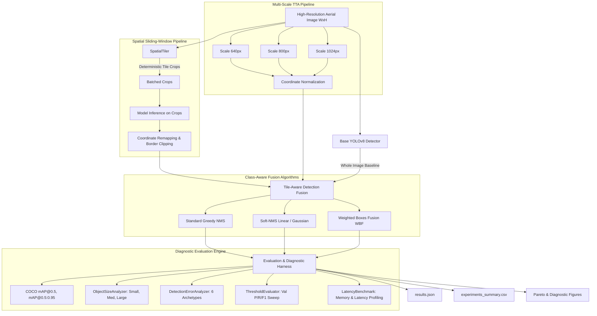

# SentinelAI Architecture & Engineering Design

## 1. System Overview

SentinelAI is an experimental research framework designed to study and alleviate the small-object detection bottleneck in aerial and optical satellite remote sensing imagery.

The core design principle is **strict modular decoupling**: the detection model, spatial sliding-window inference, coordinate remapping, multi-scale ensembling, postprocessing fusion, evaluation, and hardware profiling are isolated into distinct, swappable components.

---

## 2. Core Modules & Responsibilities

### 2.1 Dataset Protocol (`src/sentinelai/dataset/`)
- `constants.py`: DIOR 20 class labels, class ID mappings, and canonical size thresholds.
- `structures.py`: Dataclasses for `BoundingBox`, `ImageDetectionResult`, and `TileCrop`. All coordinates are standard float pixel values $[x_{min}, y_{min}, x_{max}, y_{max}]$ with automatic normalization and clipping routines.
- `loader.py`: YOLO annotation parser and export utility.

### 2.2 Inference Pipeline (`src/sentinelai/inference/`)
- `tiler.py` (`SpatialTiler`):
  - Deterministically partitions an image $[W, H]$ into sliding windows.
  - Supports configurable rectangular dimensions (`tile_width`, `tile_height`) and independent overlap ratios (`overlap_x`, `overlap_y`).
  - Edge guarantee: Shifts the final row and column backwards when $W_{img} \ge W_{tile}$ so that every tile maintains exact model input dimensions without zero-padding or scale distortion.
  - Deduplication: Eliminates any duplicate coordinates before crop extraction.
- `tiled_inference.py` (`TiledDetector`):
  - Extracts image crops and processes them in configurable batches (`batch_size`).
  - Converts tile-relative box coordinates $[x, y]$ to the global image coordinate system $[x + x_{tile}, y + y_{tile}]$.
  - Clips coordinates to valid image bounds and prunes degenerated zero-area boxes.
  - Supports an optional concurrent whole-image inference pass to retain context for macroscopic objects.
- `multiscale_inference.py` (`MultiScaleDetector`):
  - Evaluates an ensemble of input image scales (e.g., 640, 800, 1024).
  - Preserves coordinate consistency across scales and passes the unified prediction set to the selected fusion algorithm.
- `detector.py` (`YOLOv8Detector`):
  - Encapsulates model initialization, weights resolution, warmup passes, and batched inference.

### 2.3 Postprocessing & Fusion (`src/sentinelai/postprocessing/`)
- `fusion.py`:
  - `standard_nms`: Greedy class-aware NMS sorting candidates by score and suppressing overlap above `iou_threshold`.
  - `soft_nms`: Decays confidence scores continuously using Gaussian ($e^{-\text{IoU}^2 / \sigma}$) or Linear weighting.
  - `weighted_boxes_fusion`: Clusters overlapping predictions across tiles and computes consensus coordinates weighted by confidence scores. Includes pure-numpy fallback if external C-extensions are absent.

### 2.4 Diagnostic Evaluation (`src/sentinelai/evaluation/`)
- `metrics.py`: Standard all-point interpolated Average Precision (AP), mAP@0.5, and COCO-style mAP@0.5:0.95 across 10 IoU thresholds $[0.50 : 0.05 : 0.95]$.
- `size_analysis.py` (`ObjectSizeAnalyzer`): Categorizes bounding boxes by relative area ($A_{rel} = \frac{w \cdot h}{W_{img} \cdot H_{img}}$) or absolute pixel area into Small ($\le 32^2$), Medium ($32^2 < \text{area} \le 96^2$), and Large ($> 96^2$). Computes objects count, precision, recall, AP@0.5, and error distributions per size bin.
- `error_analysis.py` (`DetectionErrorAnalyzer`): Classifies model predictions and ground-truth misses into 6 specific diagnostic archetypes:
  1. Localization Error ($0.10 \le \text{IoU} < 0.50$, correct class)
  2. Class Confusion ($\text{IoU} \ge 0.10$, wrong class)
  3. Duplicate False Positive ($\text{IoU} \ge 0.50$ on already-matched ground truth)
  4. Background False Positive ($\text{IoU} < 0.10$ on any ground truth)
  5. Missed Small Object ($\text{area} \le 32^2$)
  6. Boundary Miss (Ground truth within boundary margin of image)
- `threshold_optimizer.py` (`ThresholdEvaluator`): Sweeps confidence thresholds over a grid $[0.05, 0.85]$, generates Precision/Recall/F1 vs Threshold curves, and identifies the optimal F1 threshold exclusively on validation data.

### 2.5 Experiment Runner & Profiling (`src/sentinelai/experiments/`, `src/sentinelai/utils/`)
- `configs.py`: YAML schema parser for `ExperimentConfig`, `InferenceConfig`, and `EvaluationConfig`.
- `runner.py` (`ExperimentRunner`): Executes configured experiments, records runtime metrics, and persists machine-readable JSON files and updates `experiments_summary.csv`.
- `benchmark.py` (`LatencyBenchmark`): Isolates inference latency from disk I/O, performs warmup passes, records timing statistics (mean, median, p95), and captures hardware/GPU memory specs.
